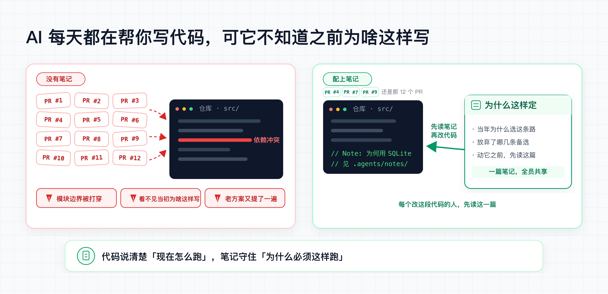

# Agent Notes · write-notes-like-deepseek

为使用 AI Agent 的代码仓库保留有长期价值的工程决策：为什么这样做、放弃了哪些真实选项、什么条件下需要重新评估。

本仓库独立维护通用 skill、模板和校验工具。名称保留用于安装兼容；不代表任何组织的官方流程，也不把其他仓库的规则作为运行依赖。



## 采用目标与兼容原则

这个版本用以下结果判断改进是否值得保留：

- 后续维护者能找到仍有效的理由，避免重复已有记录或重走已否决的方案。
- 常规改动不额外产文；已授权任务不因笔记流程重复等待确认。
- 归档不会因无效历史基线、损坏清单或普通写入错误而静默丢失历史。
- 公共包、宿主项目记录和外部全局规则各自有明确边界。
- 沿用已有目录、状态、分类和命令入口；已符合原格式的历史记录无需为升级补写不存在的理由。

维护时依据实际使用场景、已复现的问题和兼容代价取舍。共用校验和回归测试用于保障上述结果；不以改动行数、统一风格或工具更新本身作为改进目标。

## 内容边界

| 位置 | 负责什么 | 不放什么 |
| --- | --- | --- |
| 本公共 skill 仓库 | 通用判断方法、空白模板、工具、合成测试样例 | 具体使用者的项目资料、账号、内部地址、真实笔记或个人配置 |
| 宿主项目的 `.agents/notes/` | 当前项目难以从代码、测试或现有文档恢复的决策理由 | 全局个人偏好、其他项目背景、外部记忆系统的操作规则 |
| 外部 Agent 配置 | 个人或组织的跨项目规则、外部记忆系统连接与存储约定 | 不由本 skill 复制、接管或回写 |

Agent 仍须遵守当前任务及其适用的外部规则。本 skill 只负责项目内工程决策的记录方法；安装它不会启用任何跨项目同步。

项目里的记录可以包含该项目需要的信息。是否公开这些记录，由项目自身的可见性和发布范围决定，不能因为 skill 是公开的就自动公开宿主项目资料。

## 什么时候值得写

先问两个问题：**代码、测试或已有文档是否已经能解释？如果不补这条记录，后来维护者容易重复什么具体错误？** 现有材料已足以解释，或说不出独立的长期价值时，就不新增 Note。

适合记录的内容包括：难以从实现看出的取舍、反直觉的兼容限制、被实验否定且容易再次提出的方案、需要保留理由的项目级约束。小修复、机械重构、提交摘要和能从测试直接看出的行为通常不需要单独记录。

1. 搜索当前项目的有效规则和已有 Note，确认有无相同决策的记录。
2. 事实或链接变化时更新原记录；推翻原决策时另写一条，并说明替代关系。
3. 尚未决定或实现的内容使用 `proposed`；已验证的实现可直接使用 `implemented`；确定放弃的方案使用 `rejected`。
4. 只记录实际考虑过的替代方案，允许明确写“无”；不为了凑数量编造选项。
5. 记录与对应实现、测试放在同一次可审查的变更中。校验器检查结构、格式和历史完整性，内容是否真实仍需评审。
6. 记录不再具有当前约束作用但值得保留时再归档。归档历史不作为当前规则的默认依据。

对于多人或多 Agent 协作，明确相关记录的维护者和最终整合者，避免重复建档和并发覆盖。该流程沿用任务已有授权，不额外要求每条笔记都等人工确认。

## 目录与生命周期

笔记放在宿主仓库的 `.agents/notes/<status>/<class>/YYYY-MM-DD-topic.md`。

| 维度 | 可选值 |
| --- | --- |
| 状态 | `proposed`、`implemented`、`rejected`、`archived` |
| 分类 | `feature`、`bug-fix`、`simplification`、`architecture`、`process`、`testing` |

按生命周期选择正文骨架。`implemented` 使用 `Problem`、`Decision`、`Alternatives considered`、`Consequences`；`proposed` 和 `rejected` 保留方案及其相应状态所需的信息。模板位于 [templates](skills/write-notes-like-deepseek/templates)，详细规则从 [SKILL.md](skills/write-notes-like-deepseek/SKILL.md) 按需读取。

`archived` 用于保存已实施决策的历史快照。正文仍保留 `Status: implemented`，由归档脚本增加 `Archived: YYYY-MM-DD`，并在 `archived/manifest.json` 中记录 SHA-256。归档后的正文和已有 manifest 条目不可重写；后续纠正用新记录说明。

## 安装当前分支

宿主工具沿用原有的 **`npx tsx`** 调用方式，无需为了这个版本统一迁移 Node。首次调用可能需要获取 `tsx`；已有 Node.js 24 或更新版本的环境，也可以把下文的 `npx tsx` 换成 `node`，直接执行脚本。

当前改动位于 `chore/generic-rules-and-archive-validation` 分支。为明确安装来源，先把这个分支检出到一个独立目录；替换下面的示例绝对路径：

```bash
git clone --single-branch \
  --branch chore/generic-rules-and-archive-validation \
  https://github.com/ripples-alive/write-notes-like-deepseek.git \
  /absolute/path/to/agent-notes-skill-source
```

然后进入要使用该 skill 的**宿主项目根目录**执行：

```bash
npx --yes skills@1.7.1 add /absolute/path/to/agent-notes-skill-source \
  --skill write-notes-like-deepseek --agent codex
```

可按所用 Agent 更换 `--agent`，需要复制安装时增加 `--copy`。安装器可能需要联网获取 CLI。安装只包含 `skills/write-notes-like-deepseek/` 下的内容，不包含本仓库的维护规则、测试样例或项目笔记。

安装器不会自动修改宿主项目的 `package.json`、启用 CI、设置分支保护或创建外部存储。确有需要时，在任务授权范围内完成这些接入步骤。

### 在宿主项目中运行

以下使用项目级安装的默认路径；如果安装到了其他位置，将命令中的 skill 路径替换为实际位置。**工作目录始终是宿主项目根目录**：

```bash
npx tsx .agents/skills/write-notes-like-deepseek/scripts/verify-agent-note-tree.ts
npx tsx .agents/skills/write-notes-like-deepseek/scripts/verify-agent-note-format.ts
npx tsx .agents/skills/write-notes-like-deepseek/scripts/verify-archived-agent-notes.ts
```

默认检查当前工作目录下的 `.agents/notes/`。`AGENT_NOTE_ROOT` 可以指定其他笔记根目录；相对路径仍以当前工作目录为准。

```bash
npx tsx .agents/skills/write-notes-like-deepseek/scripts/archive-agent-note.ts \
  .agents/notes/implemented/architecture/2026-01-01-example-decision.md
```

该命令在移动文件前检查输入、manifest、已有归档和可用的 Git 历史基线。损坏的 manifest 不会被重建为一个空历史；错误必须先解决。

### 接入 CI

将 [verify-notes.yml 模板](skills/write-notes-like-deepseek/templates/verify-notes.yml) 复制到宿主项目的 `.github/workflows/verify-notes.yml`，并确认 CI 能访问已安装的 skill 文件。如果项目不提交 skill 文件，应在校验前从自己选定且固定的来源安装。

归档检查有两个不同层次：

- **当前一致性**：磁盘中的归档文件与 manifest 匹配。
- **历史追加约束**：相对于指定 Git 提交，既有 manifest 条目没有删除或改变。改正文后同时重算哈希，仍应被历史对比拦下。

`AGENT_NOTE_ARCHIVE_BASE_REF` 指定历史基线。PR 使用目标分支基线，普通 push 使用推送前提交；模板会显式处理新分支的全零 `before`，而不会把它当成有效提交。使用手动触发或无父提交的初始化时，基线为 `HEAD`，只能检查当前状态和工作区差异，不能证明之前的变更遵守追加约束。

显式给出的无效或未获取基线会报错。合法基线中尚无 manifest 则允许首次建立归档。非 Git 目录可以检查当前文件，但无法提供 Git 历史保证；要在合并前强制执行，还须在宿主项目设置必需检查。

### 可选看板

```bash
npx tsx .agents/skills/write-notes-like-deepseek/scripts/build-board.ts \
  --init board.html '工程决策看板'
npx tsx .agents/skills/write-notes-like-deepseek/scripts/build-board.ts \
  --bundle .agents/notes demo.html '工程决策看板'
```

轻量页面用于本地浏览，内联导出会把笔记内容写入 HTML。`--metadata-only` 仅省略正文，标题、路径、关系等仍可能含敏感信息，不能作为自动脱敏或对外发布的保证。

## 维护这个仓库

通用维护约定见 [AGENTS.md](AGENTS.md)。本仓库只向自己的分支提交和发布；没有向其他仓库自动同步、导入示例或创建 PR 的流程。

仓库开发和回归测试使用 Node.js 24，与既有 CI 环境一致。这个测试环境要求与宿主使用入口分开维护。

```bash
npm test
npm run verify-notes
```

`npm test` 离线运行归档安全回归测试和复制/链接布局的宿主项目测试，覆盖安装内容边界、从宿主目录调用工具、错误格式拒绝、归档与看板生成。它不把模拟布局检查称为真实安装器验证。

新记录使用当前模板。对已经采用旧格式标记的历史记录，保留原来的窄兼容规则，详见 [格式说明](skills/write-notes-like-deepseek/references/note-format.md)；不要为了升级补造备选方案或改写已封印历史。

如需验证固定版本安装器的实际行为，另外运行：

```bash
npm run test-skill-install
```

该集成测试通过 `skills@1.7.1` 从**本地检出的本仓库**安装，覆盖 Codex / Claude Code 的默认安装与 `--copy`，可能联网获取安装器本身，不访问其他项目的示例资料。

## 来源说明

这个项目由 `czm15053/write-notes-like-deepseek` 的历史版本派生，保留原名称以延续兼容性。此处仅说明出处；当前规则、发布和维护独立进行，不代表原作者或 DeepSeek 官方认可，也不要求访问它们的仓库。

本版本移除了指向缺失 `LICENSE` 文件的徽章与链接；没有新增或代原作者补写许可授权。
